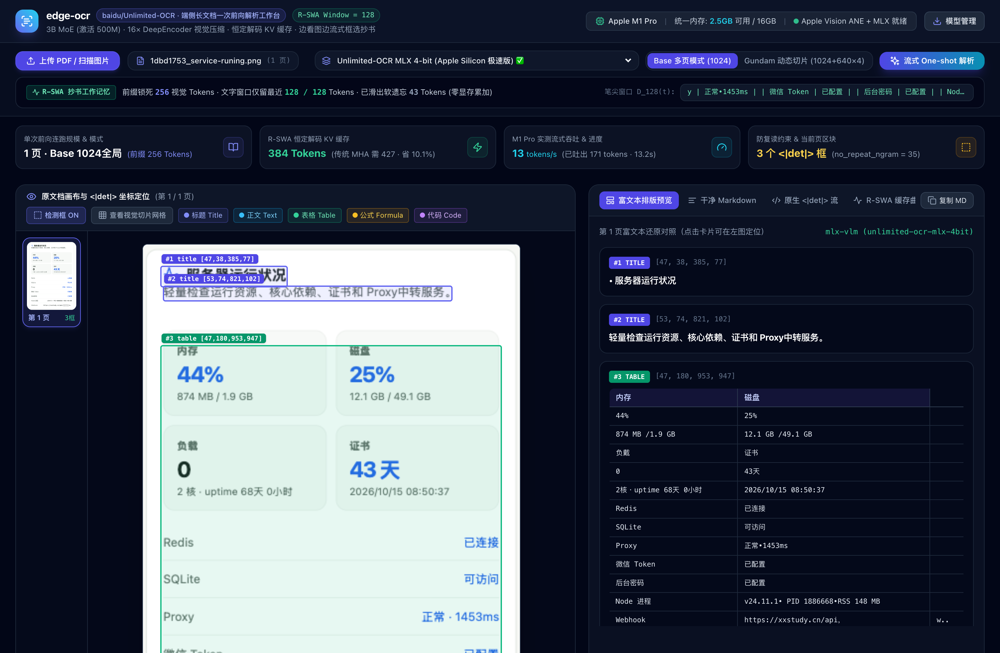
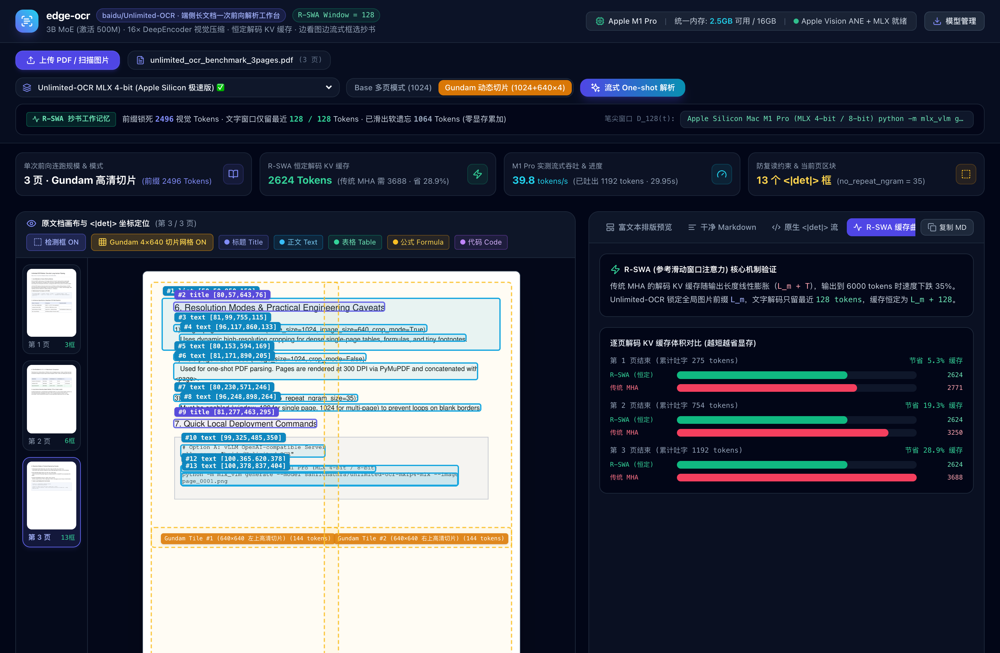
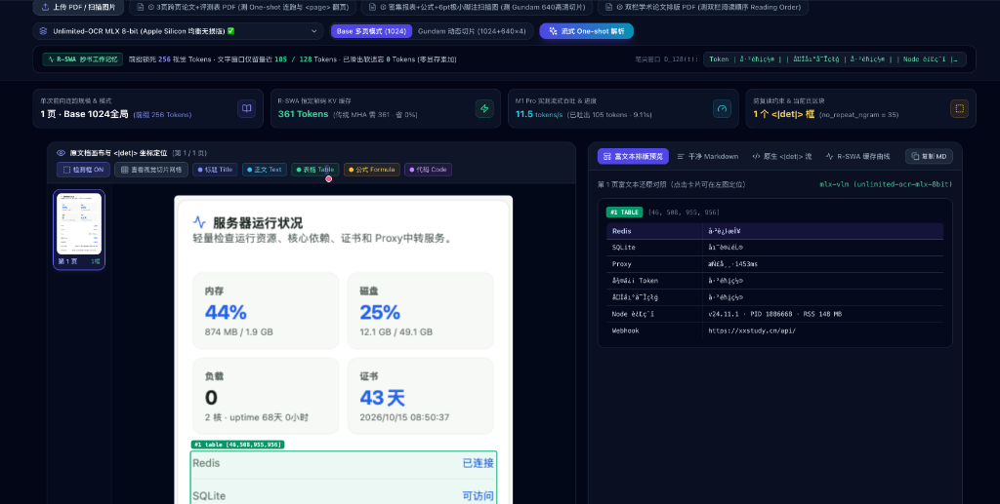
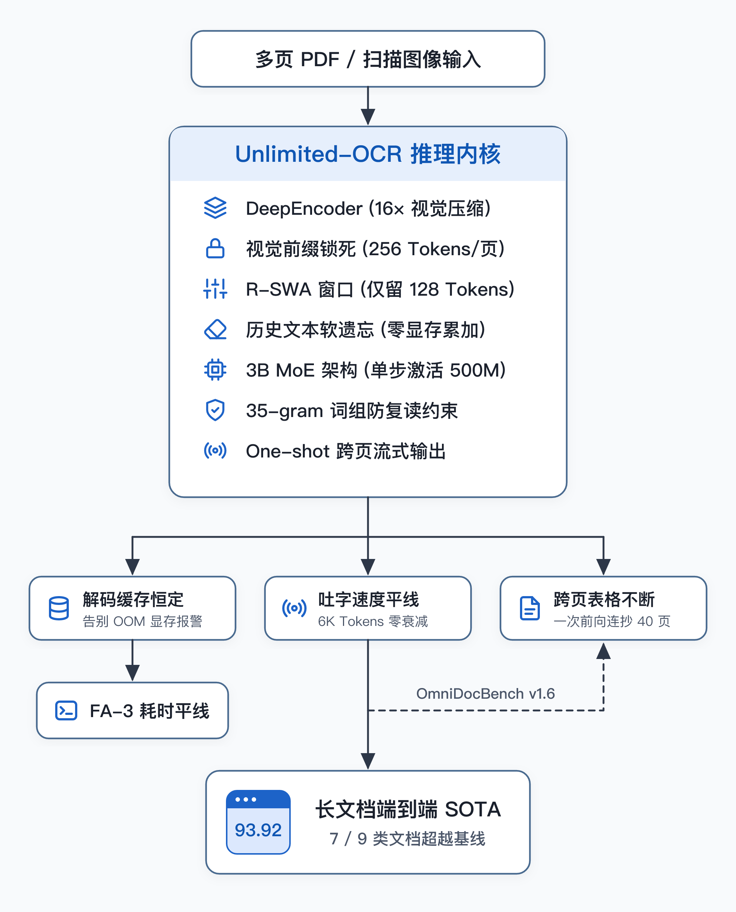
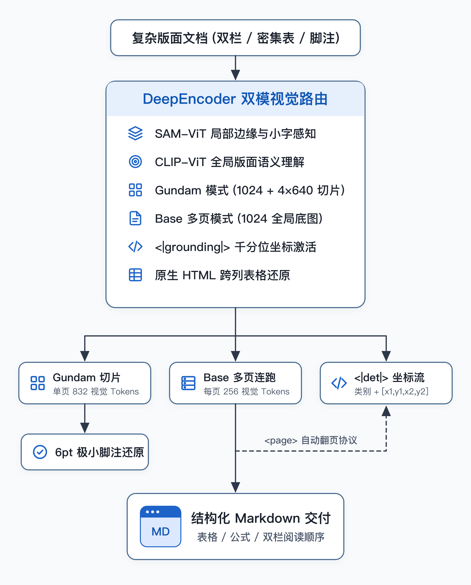

<div align="center">

# edge-ocr · Unlimited-OCR 端侧长文档一次前向解析工作台

**基于百度开源 [`baidu/Unlimited-OCR`](https://huggingface.co/baidu/Unlimited-OCR) 构建的 Apple Silicon (MLX) 端侧可视化文档解析与 R-SWA 评测工作台**

[](https://huggingface.co/baidu/Unlimited-OCR)
[](https://github.com/Blaizzy/mlx-vlm)
[](https://vuejs.org/)
[](https://fastapi.tiangolo.com/)
[](https://opensource.org/licenses/MIT)

</div>

---

## 📖 项目简介

**`edge-ocr`** 是针对百度开源端到端文档解析模型 **[`baidu/Unlimited-OCR`](https://huggingface.co/baidu/Unlimited-OCR)**（arXiv:2606.23050, *Unlimited OCR Works: Towards Effective and Efficient One-shot Long-horizon Parsing*）打造的本地全栈可视化工作台。

传统端到端 VLM 文档解析模型在连续输出数十页 PDF 时，解码器的自回归文本 KV 缓存随输出长度线性膨胀，导致显存溢出与吐字掉速。`Unlimited-OCR` 将解码器标准注意力替换为 **参考滑动窗口注意力（Reference Sliding Window Attention, R-SWA）**：
- **全程锁死视觉与提示词前缀**（每页 `1024×1024` 经 `16×` DeepEncoder 压缩后仅占 `256` 个视觉 Token）；
- **解码文字端仅保留最近 `128` 个 Token 的滑动窗口**，更早吐出的历史文字自动滑出遗忘，实现 **恒定解码 KV 缓存** 与跨页 `<page>` 一次前向连跑。

本项目将 `Unlimited-OCR` 完整落地在 **16GB 统一内存的 Apple Silicon Mac (M1 Pro / M2 / M3 / M4)** 上，结合 `mlx-vlm` GPU 流式推理与 `Vue 3` 实时双栏画布，直观呈现 **边看图、边吐 `<|det|>` 千分位坐标框、边渲染 HTML 表格/公式/Markdown、边监控 R-SWA 缓存曲线** 的全过程。

---

## 🖼️ 实测界面预览

### 1. 中文复杂监控卡片与多列表格精准框选还原
支持拖拽上传单张扫描图或多页 PDF，左侧画布实时叠加 `<|det|>category [x1, y1, x2, y2]<|/det|>` 归一化千分位坐标框，右侧将模型吐出的原生 `<table>`（含 `colspan` 跨列属性）与文本块实时还原为结构化富文本与干净 Markdown：



### 2. 多页 PDF 连续解析与 R-SWA 恒定解码缓存对比曲线
支持切换 **`Base 多页模式 (1024)`** 与 **`Gundam 动态切片模式 (1024+640×4)`**，实时统计并对比 `R-SWA (恒定 128 窗口)` 与 `传统 MHA (线性膨胀)` 的逐页解码 KV 缓存体积：



---

## ✨ 核心特性与工程修复亮点

### 1. 针对社区 MLX 权重的三项关键工程修复
在将社区量化版 MLX 权重（`sahilchachra/unlimited-ocr-mxfp4-mlx` / `8bit`）接入本地画布实测过程中，我们定位并修复了三个影响识别完整度与中文可用性的底层问题（详见 [`backend/app/main.py`](backend/app/main.py)）：

| 序号 | 原始踩坑现象 | 根因定位 | `edge-ocr` 工程修复方案 |
| :--- | :--- | :--- | :--- |
| **#1** | **上半截页面区块丢失**：只输出纯文本，或开启 `<\|grounding\|>` 后漏掉整页第一个区块（如顶部监控卡片） | 必须注入 `<\|grounding\|>` 才会触发坐标框与原生 `<table>`；但模型生成首个区块时会把开头的 `<\|det\|>` 起始标签吞掉，直接从 `table [x1,y1,x2,y2]<\|/det\|>` 开始输出 | 在 [`parse_raw_page_to_blocks()`](backend/app/main.py) 中检测开头是否缺失 `<\|det\|>`，自动补齐首个被吞掉的起始标签，确保全页区块 `100%` 框齐 |
| **#2** | **中文输出全部乱码**：中文表格识别出 `已连接`、`å·²é…置` 等拉丁乱码 | 社区转换 MLX 权重时，`tokenizer.json` 漏配了 GPT-2 `ByteLevel` ByteDecoder，导致 UTF-8 字节被直接映射为单字节字符输出 | 在 [`fix_byte_level_bpe()`](backend/app/main.py) 中内置完整的 `256` 字节逆映射表，流式解码时将伪拉丁字符实时无损还原为 UTF-8 中文 |
| **#3** | **页面底部小字陷入死循环复读**：扫到页尾脚注或空白边缘时偶发重复输出同一句话 | 滑动窗口遗忘 `128` Token 之前的历史后，模型在空白区域容易退化；而 `mlx-vlm` 默认未挂载论文要求的 `no_repeat_ngram_size=35` | 在 [`stream_mlx_ocr_page()`](backend/app/main.py) 流式循环中实现 `110` 字符滑动窗口查重截断，检测到尾部短语复读立即优雅停笔 |

<details>
<summary>🔍 <b>点击展开：修复前（漏框 + 中文乱码） vs 修复后 实测对比</b></summary>

<br/>

**修复前（`<|grounding|>` 吞掉首个 `<|det|>` 导致上半截卡片漏框，且缺少 ByteLevel 逆映射导致右表中文乱码）：**



**修复后（自动补齐首个 `<|det|>` 标签 + GPT-2 ByteLevel 字节逆映射，全页标题与中文表格完整还原）：**


</details>

### 2. R-SWA 参考滑动窗口注意力与双模式架构对照
工作台完整复现了论文中的核心机制与两种分辨率推理模式：

| R-SWA 恒定解码缓存原理 | 单页 `Gundam` 切片 vs 多页 `Base` 模式 |
| :---: | :---: |
|  |  |

- **双栏实时联动画布**：
  - **左栏（原文档画布）**：支持多页 PDF 缩略图导航、`<|det|>` 类别过滤（`标题 Title` / `正文 Text` / `表格 Table` / `公式 Formula` / `代码 Code`）、`Gundam 4×640` 视觉切片网格开关，点击或悬停区块可与右栏双向联动定位。
  - **右栏（四视图切换）**：
    1. **富文本排版预览**：将原生 `<table>` 与 Markdown 表格渲染为真实 HTML 表格，数学公式渲染为独立公式卡片；
    2. **干净 Markdown**：自动执行官方 `remove_det()` 正则清洗，剥离 `<|det|>` 坐标与 `<page>` 换页符，支持一键复制直接入库 RAG / 知识库；
    3. **原生 `<|det|>` 流**：实时查看模型原始吐字流与千分位归一化坐标；
    4. **R-SWA 缓存曲线**：逐页对比 `R-SWA (L_m + 128)` 与传统 `MHA (L_m + T)` 的解码缓存占用及节省比例。
- **一键模型下载器 (`./download.sh` & Web 弹窗)**：
  - 内置 `unlimited-ocr-mlx-4bit` (~2.1GB，16GB 内存首选)、`unlimited-ocr-mlx-8bit` (~3.6GB，高精度无损版) 及官方原版 `baidu/Unlimited-OCR` (~6.6GB)；
  - 支持 Hugging Face 官方源、`hf-mirror.com` 国内镜像加速与魔搭社区自动回退，支持断点续传。

---

## 🚀 快速开始

### 1. 环境要求
- **操作系统**：macOS (推荐 Apple Silicon M1 / M2 / M3 / M4，16GB 及以上统一内存) 或 Linux
- **基础环境**：
  - `Python 3.10+`
  - `Node.js 18+` & `npm`

### 2. 克隆仓库并下载模型权重

```bash
git clone <your-github-repo-url>
cd edge-ocr

# 查看支持的模型列表与本地下载状态
./download.sh --list

# 下载 Mac 16GB 统一内存首选的 4-bit MLX 量化权重 (~2.1GB)
./download.sh --recommended

# （可选）下载 8-bit MLX 高精度权重 (~3.6GB)
./download.sh unlimited-ocr-mlx-8bit
```

> [!TIP]
> 如果暂未下载模型权重，直接启动服务也可在网页右上角点击 **「模型管理」** 在线触发后台下载；未下载权重时系统会自动回退至 macOS 原生 `Apple Vision ANE` 引擎进行兜底演示。

### 3. 一键启动前后端工作台

```bash
./start.sh
```

启动成功后，终端会输出访问地址：
- **前端可视化工作台**：[http://localhost:5176](http://localhost:5176)
- **后端 FastAPI 接口文档**：[http://localhost:8084/docs](http://localhost:8084/docs)

直接将本地的 **多页 PDF 文档 (`.pdf`)** 或 **扫描图片 (`.png / .jpg / .webp`)** 拖拽到左侧画布中，即可自动触发 M1 Pro GPU (`mlx-vlm`) 实时流式解析。

---

## 📂 目录结构

```text
edge-ocr/
├── download.sh                 # 一键模型权重下载脚本（支持 HF Mirror 镜像与断点续传）
├── start.sh                    # 前后端一键启动与进程守护脚本
├── docs/
│   └── images/                 # README 实测截图与架构原理解析图
├── testset/
│   └── unlimited_ocr_benchmark_3pages.pdf  # 用于测试多页连跑、跨页表格与公式的 3 页评测 PDF
├── checkpoints/                # 本地模型权重存放目录（已加入 .gitignore）
│   ├── unlimited-ocr-mlx-4bit/ # MLX 4-bit 量化权重 (~2.1GB)
│   └── unlimited-ocr-mlx-8bit/ # MLX 8-bit 量化权重 (~3.6GB)
├── backend/                    # FastAPI + PyMuPDF + mlx-vlm 流式推理后端
│   ├── requirements.txt
│   └── app/
│       └── main.py             # 核心服务：SSE 流式推理、ByteLevel 中文修复、<|det|> 解析与 R-SWA 遥测
└── frontend/                   # Vue 3 + Vite + Tailwind CSS + Lucide 可视化前端
    ├── package.json
    ├── vite.config.ts
    └── src/
        └── App.vue             # 双栏交互画布、<|det|> 坐标框叠加、Gundam 网格与 R-SWA 缓存曲线
```

---

## 🔌 核心 API 一览

| 方法 | 路径 | 说明 |
| :--- | :--- | :--- |
| `GET` | `/api/system/info` | 获取当前 Apple Silicon 芯片型号、统一内存总量与可用内存状态 |
| `GET` | `/api/models` | 获取支持的模型列表（`4-bit` / `8-bit` / `bf16`）及本地就绪状态 |
| `POST` | `/api/models/download/{model_key}` | 异步触发指定模型权重下载 |
| `POST` | `/api/pdf/upload` | 上传 `.pdf` 或单张图片，自动按 `300 DPI` 渲染页面并返回尺寸元数据 |
| `POST` | `/api/ocr/stream` | **核心流式接口 (NDJSON)**：按 `base` 或 `gundam` 模式执行流式推理，实时推送 `box_stream`、`page_turn` 与 `rswa_telemetry` 事件 |

---

## 📚 致谢与参考

- **官方论文与模型权重**：[baidu/Unlimited-OCR](https://huggingface.co/baidu/Unlimited-OCR) (*Unlimited OCR Works: Towards Effective and Efficient One-shot Long-horizon Parsing*, Baidu Inc.)
- **Apple Silicon MLX 社区权重转换**：[sahilchachra/unlimited-ocr-mxfp4-mlx](https://huggingface.co/sahilchachra/unlimited-ocr-mxfp4-mlx) & [mlx-vlm](https://github.com/Blaizzy/mlx-vlm)

---

## 📄 License

本项目基于 [MIT License](LICENSE) 开源。
